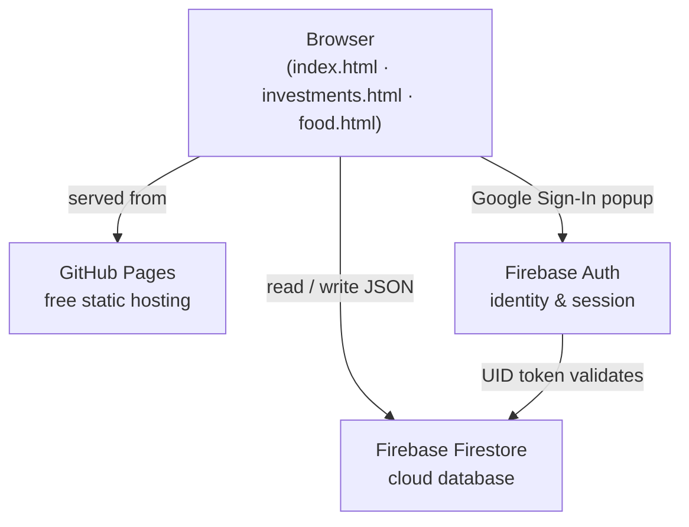
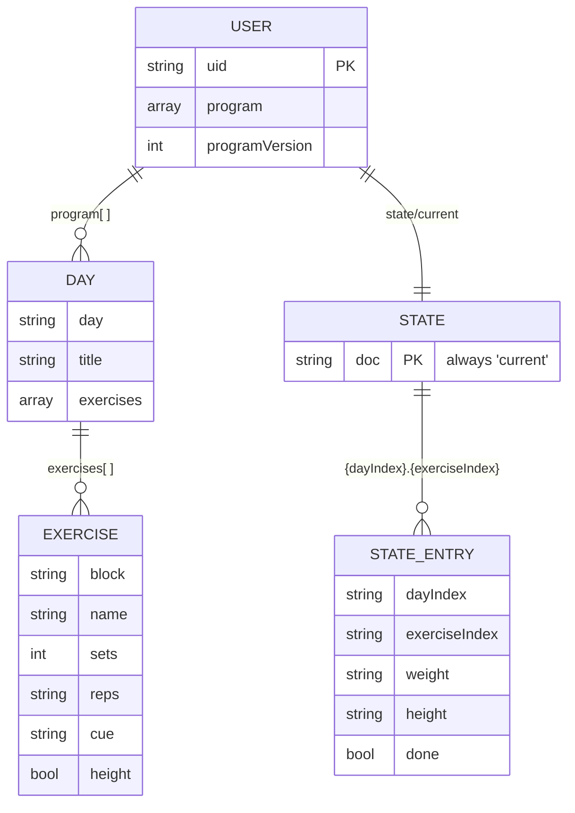
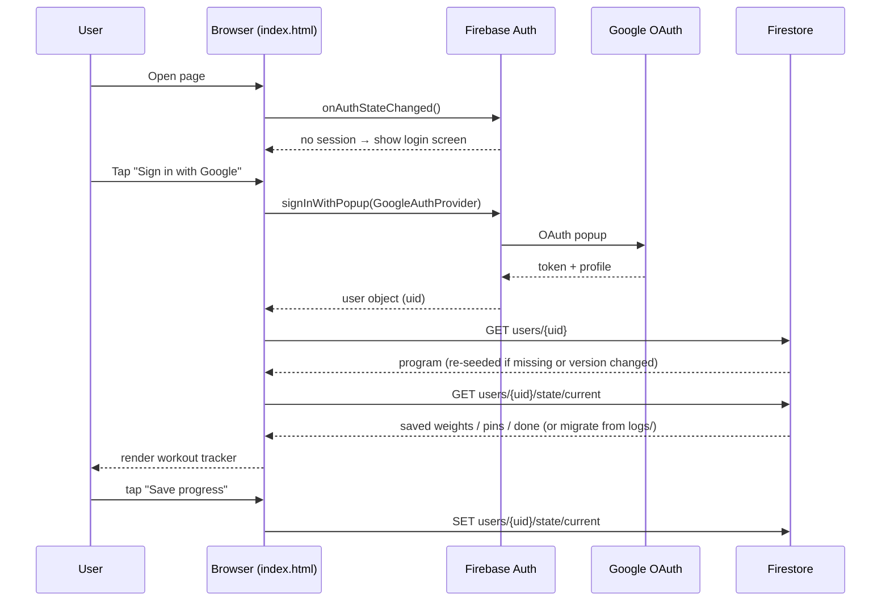

# Sarath Lifts · Sarath Invests · Sarath Eats

Three small personal apps. Each is a single HTML file with a Firebase backend (Google Sign-In + Firestore), hosted free on GitHub Pages. All three share one Firebase project, one theme, and the same conventions.

| App | File | What it does |
|-----|------|--------------|
| **Sarath Lifts** | `index.html` | Gym workout tracker: editable multi-day program, per-exercise weight / seat pin / done |
| **Sarath Invests** | `investments.html` | Compound interest calculator with saved, comparable projections |
| **Sarath Eats** | `food.html` | Food, protein and body-composition tracker (in progress, spec in `readme-food-tracker.md`) |

---

## Architecture



No build step, no framework, no npm. Firebase compat SDK 10.12.2 is loaded from the gstatic CDN. Invests also loads Chart.js 4.4.1 from cdnjs.

---

## Firestore path structure

```
users/                            ← collection
  {uid}                           ← user document (Lifts program lives here)
    ├── state/
    │     └── current             ← Lifts: persistent weights, seat pins, done flags
    ├── logs/
    │     └── {YYYY-MM-DD}        ← Lifts: legacy daily logs (read once for migration only)
    ├── scenarios/
    │     └── {autoId}            ← Invests: saved projections
    ├── foodSettings/ foods/ meals/ foodLog/ bodyLog/
    │                             ← Eats (see readme-food-tracker.md)
```

All data is scoped to the authenticated user's UID. No shared state, no server.

---

## Sarath Lifts (`index.html`)

### Data model



### `users/{uid}` — the user document

Stores the entire editable workout program as a single `program` field, plus the version of the built-in default it was seeded from.

```json
{
  "programVersion": 3,
  "program": [
    {
      "day": "Day 1",
      "title": "Push & Heavy Legs",
      "exercises": [
        {
          "block": "Warm-up",
          "name": "90/90 Hip Switches",
          "sets": 1,
          "reps": "5/side",
          "cue": "Improves hip mobility to save lower back",
          "height": false
        },
        {
          "block": "A",
          "name": "Machine Chest Press",
          "sets": 4,
          "reps": "8-10",
          "cue": "Best machine for chest hypertrophy; keep shoulders pinned back. Use safe low-displacement angle.",
          "height": true
        }
      ]
    }
  ]
}
```

- Created automatically on first login, seeded from `DEFAULT_PROGRAM` in the source.
- Updated whenever the user saves from the **Edit Program** screen (days are renumbered `Day 1…N` on save).
- `height: true` means the exercise shows a Seat/pin input.
- **`PROGRAM_VERSION`**: if the stored `programVersion` differs from the constant in the source, the program is replaced with `DEFAULT_PROGRAM` on next load. Bump it only when the default program text or structure changes, and note that it overwrites any edits made in the app.

### `users/{uid}/state/current` — persistent progress

One document holding the latest weight, seat pin and done flag for every working exercise. It persists across days, so the last weight you used is always pre-filled. Keys are the **zero-based day index**, then the **zero-based exercise index** within that day's flat `exercises` array. Warm-ups (block `"Warm-up"`) have no inputs and are never stored.

```json
{
  "0": {
    "2": { "weight": "135", "height": "3", "done": true  },
    "3": { "weight": "90",  "height": "5", "done": false }
  },
  "1": {
    "2": { "weight": "100", "height": "4", "done": false }
  }
}
```

Key `"0"."2"` → `program[0].exercises[2]` (the first working exercise in Day 1 after two warm-ups).

- Written when you tap **Save progress**.
- **Reset** clears only the `done` flags (after a styled confirm modal); weights and seat pins are kept.
- Because entries are keyed by position, reordering or deleting exercises in the editor shifts which saved values line up with which exercise.

### `users/{uid}/logs/{YYYY-MM-DD}` — legacy

The original design wrote one document per calendar day. These are no longer written. On first load, if `state/current` is empty, all log documents are merged oldest → newest (latest weight wins), `done` flags are cleared, and the result is saved as `state/current`.

### Auth & data flow



---

## Sarath Invests (`investments.html`)

Compound interest calculator.

- Inputs: initial investment, monthly contribution, years, annual rate, optional rate variance (±%), compound frequency (annual, semi-annual, quarterly, monthly, daily).
- Contributions are added monthly; the compound frequency is converted to an effective monthly rate.
- Results: final balance, total contributed, interest earned. With variance, pessimistic / base / optimistic cards and dashed lines on the chart (pessimistic rate is floored at 0%).
- Chart.js stacked bar (contributions + interest per year) and a collapsible year-by-year table (every year up to 20, then every 5).
- **Saved projections**: name and save, load to edit (Update or Save as New), double-click to rename, delete. Each row shows its final balance.
- **Projection comparison**: appears once 2+ projections are saved; compares the checked ones side by side.

### `users/{uid}/scenarios/{autoId}`

```json
{
  "name": "Retirement Fund",
  "principal": 10000,
  "monthly": 500,
  "years": 30,
  "rate": 7,
  "variance": 2,
  "freq": 12,
  "savedAt": "<server timestamp>"
}
```

---

## Sarath Eats (`food.html`)

Food and body-composition tracker built to sit alongside the other two. The full build spec, data model and phases are in [`readme-food-tracker.md`](readme-food-tracker.md). Pure logic is tested with `node --test`.

---

## Security rules

Paste into **Firebase Console → Firestore → Rules**. Each user can only read and write their own data. The wildcard covers every subcollection used by all three apps (`state`, `logs`, `scenarios`, and the Eats collections).

```
rules_version = '2';
service cloud.firestore {
  match /databases/{database}/documents {
    match /users/{uid} {
      allow read, write: if request.auth != null && request.auth.uid == uid;
    }
    match /users/{uid}/{document=**} {
      allow read, write: if request.auth != null && request.auth.uid == uid;
    }
  }
}
```

Also make sure your GitHub Pages domain and `localhost` are listed under **Firebase Console → Authentication → Settings → Authorized domains**.

---

## Running locally

```
python3 -m http.server 8000
```

Then open `http://localhost:8000/` (Lifts), `/investments.html` or `/food.html`.

---

## Stack & cost

| Layer    | Tool                          | Free tier limits                                  | Cost |
|----------|-------------------------------|---------------------------------------------------|------|
| Hosting  | GitHub Pages                  | Unlimited for public repos                        | $0   |
| Auth     | Firebase Auth (Google Sign-In)| Unlimited Google sign-ins                         | $0   |
| Database | Firebase Firestore (Spark)    | 1 GB storage · 50k reads/day · 20k writes/day     | $0   |

A workout session writes one document and reads two or three. A day of food logging writes one document per change burst (debounced). The free tier is effectively unlimited for personal use.
