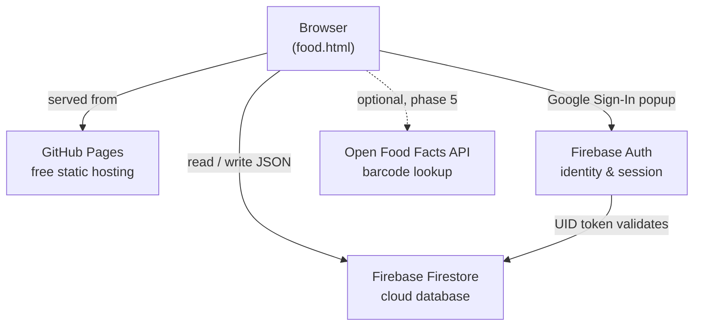
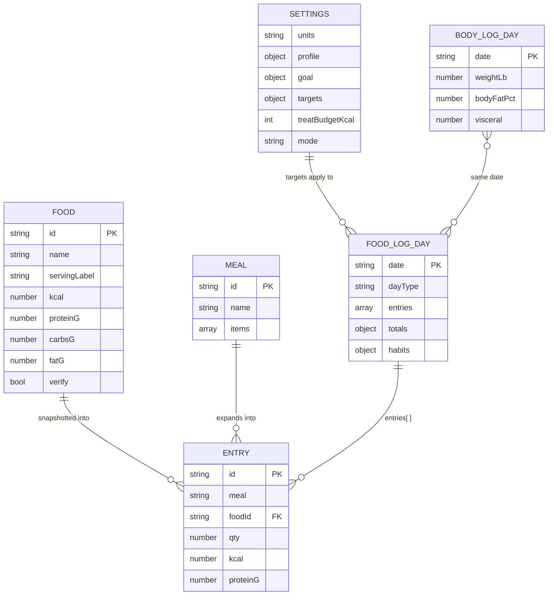
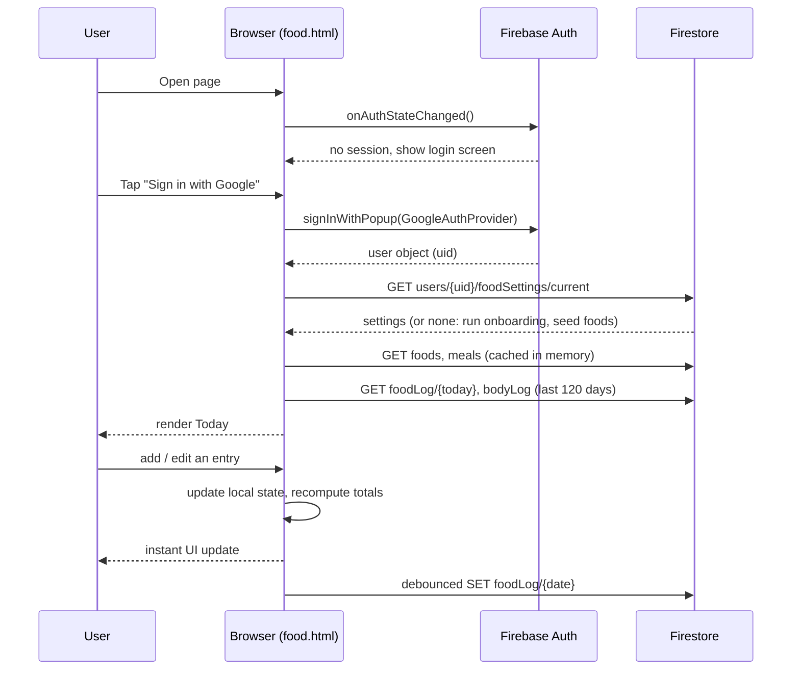

# Sarath Eats

A cross-device food and body-composition tracker, built to sit next to **Sarath Lifts** (`index.html`) and **Sarath Invests** (`investments.html`). One HTML file, Firebase backend, hosted free on GitHub Pages.

This document is the build spec. It is written for Claude Code: read it fully, then read `index.html` and `README.md` in this repo before writing anything, and copy their conventions.

**Also read `food-tracker-context.private.md` in this folder.** It holds the user's personal context (goals, health and injury notes, schedule, eating habits). That file is git-ignored on purpose because the repository is public. Use it to inform design decisions, but never copy its contents into tracked files, seeds, tests or commit messages.

---

## 1. Purpose and design philosophy

The tracker helps one person hit a daily calorie and protein target during a fat-loss phase, while keeping muscle, and see whether the plan is working. The person cooks and eats mostly Indian food (curry, dal, sambar, rasam, dosa, rice, yogurt), uses protein powder and bars, and wants a plan that does not feel like sacrifice.

Principles that drive every decision:

1. **Protein is the primary number.** Calories matter, but the main progress ring is protein. Calories, carbs and fat are secondary.
2. **Logging must take under 20 seconds per meal.** Recents, favorites, saved meals, "copy yesterday", and quick-add (calories + protein only) must be one or two taps away.
3. **Indian food is a first-class citizen.** Seed foods, serving units (katori, ladle, piece), and a prompt for hidden cooking oil are built in, not afterthoughts.
4. **Nothing is forbidden.** Snacks like murukku and sweets are logged like anything else. A daily **treat budget** makes them planned, not guilty.
5. **Non-punitive design.** Going over target is amber, never red. No streak counters that reset to zero. Festival and restaurant days are first-class "flex days". Copy never shames.
6. **Judge by trends, not single days.** Weight is noisy (water, salt, hydration). All guidance uses 7-day and 14-day trends.
7. **Mobile first.** Used one-handed on a phone, mostly in the kitchen or at a restaurant.
8. **No personal data in the repo.** See Section 11.

Out of scope: medical advice, diagnosing anything, recommending supplements, social features, ads.

---

## 2. Architecture

Same stack as the other two pages. No build step, no framework, no npm.



| Layer    | Tool                           | Notes                                        | Cost |
|----------|--------------------------------|----------------------------------------------|------|
| Hosting  | GitHub Pages                   | Same repo as the other trackers              | $0   |
| Auth     | Firebase Auth (Google Sign-In) | Reuse the existing Firebase project          | $0   |
| Database | Firebase Firestore (Spark)     | New subcollections under `users/{uid}`       | $0   |

### Hard constraints

- **One file: `food.html`** next to `index.html`. Vanilla HTML, CSS and JS. Inline `<style>` and `<script>`.
- Firebase **compat** SDK **10.12.2** from the same gstatic CDN URLs `index.html` uses (`firebase-app-compat`, `firebase-auth-compat`, `firebase-firestore-compat`). No other third-party scripts or fonts.
- **Reuse the `firebaseConfig` from `index.html` verbatim** (copy it, do not invent values). Firebase web config values are public identifiers. Security comes from Firestore rules and the authorized-domains list, not from hiding the config.
- **Reuse the CSS variables, dark/light mode, header, toast, modal and button styles** from `index.html` so the three apps look like one product. Accent color stays `--accent`.
- Include `<meta name="viewport" ... maximum-scale=1>` as the other pages do. Inputs use `font-size: 16px` or larger so iOS Safari does not zoom.
- Touch targets at least 44 px tall.
- Keep each concern in a clearly commented section of the single script (see Section 12). Pure functions (totals, trend, recommendations) must not touch the DOM or Firebase, so they can be tested in isolation.
- Optional: add a small link to `food.html` in the headers of the other two pages. If done, it is its own commit and does not change anything else in those files.

---

## 3. Firestore structure

All data is scoped to the signed-in user's UID. Same pattern as the existing app.

```
users/                              <- collection
  {uid}                             <- document (existing; do not overwrite fields you do not own)
    |-- foodSettings/               <- subcollection
    |     `-- current               <- one settings document
    |-- foods/                      <- subcollection: the user's food library
    |     `-- {foodId}
    |-- meals/                      <- subcollection: saved meals (combos)
    |     `-- {mealId}
    |-- foodLog/                    <- subcollection: one document per calendar day
    |     `-- {YYYY-MM-DD}
    `-- bodyLog/                    <- subcollection: one document per calendar day
          `-- {YYYY-MM-DD}
```

Never write to the existing `program`, `programVersion`, `state`, `logs` or `scenarios` data. When touching `users/{uid}` itself, always use `{ merge: true }`.

### Data model



### `users/{uid}/foodSettings/current`

Created by the onboarding screen on first login. Nothing here is hard-coded in the source.

```json
{
  "version": 1,
  "units": "lb",
  "profile": {
    "sex": "male",
    "birthDate": "YYYY-MM-DD",
    "heightIn": 68,
    "activityFactor": 1.4
  },
  "goal": {
    "startDate": "YYYY-MM-DD",
    "startWeightLb": 0,
    "goalWeightLb": 0,
    "goalBodyFatPct": 15,
    "targetDate": "YYYY-MM-DD",
    "ratePerWeekLb": 0.75
  },
  "targets": {
    "kcal": 2000,
    "proteinG": 150,
    "proteinMinG": 135,
    "carbsG": 200,
    "fatG": 60,
    "fiberG": 30,
    "floorKcal": 1800
  },
  "treatBudgetKcal": 160,
  "maintenanceKcalEstimate": 2400,
  "mode": "cut",
  "modeUntil": null,
  "checklist": [
    { "id": "supp1", "label": "Morning supplement stack", "defaultOn": true },
    { "id": "supp2", "label": "Evening supplement", "defaultOn": true }
  ],
  "updatedAt": 0
}
```

- `mode` is `"cut"` or `"maintain"`. `modeUntil` is a date or `null`. See "Maintenance weeks" in Section 5.
- `checklist` is user-editable (Section 5.8). The two defaults above are placeholders.
- The values shown are neutral examples. Real values come from onboarding.

### `users/{uid}/foods/{foodId}`

```json
{
  "id": "6f1c...",
  "name": "Rice, cooked basmati",
  "brand": "",
  "servingLabel": "1 cup cooked",
  "servingGrams": 158,
  "kcal": 205,
  "proteinG": 4.3,
  "carbsG": 45,
  "fatG": 0.4,
  "fiberG": 0.6,
  "category": "grain",
  "tags": ["indian", "staple"],
  "source": "seed",
  "verify": true,
  "favorite": false,
  "useCount": 0,
  "lastUsed": 0,
  "notes": ""
}
```

- `source` is `"seed"`, `"custom"` or `"label"`.
- `verify: true` means the numbers are rough defaults. The UI shows a small `~` badge until the user opens the food and taps **Confirm values** (which sets `verify: false`).
- All macro fields are **per serving** (per `servingLabel`), not per 100 g.

### `users/{uid}/meals/{mealId}`

A saved combination, e.g. "Usual lunch".

```json
{
  "id": "a91b...",
  "name": "Usual lunch",
  "defaultMeal": "lunch",
  "items": [
    { "foodId": "6f1c...", "qty": 1 },
    { "foodId": "b2d0...", "qty": 1 }
  ],
  "useCount": 0,
  "lastUsed": 0
}
```

Totals are computed on read from the current food values. Applying a meal creates normal entries (snapshotted).

### `users/{uid}/foodLog/{YYYY-MM-DD}`

One document per local calendar day. Keep the whole day in one document and write it whole (`set` with merge), debounced about 600 ms after the last change.

```json
{
  "date": "2026-11-23",
  "dayType": "normal",
  "entries": [
    {
      "id": "e1",
      "meal": "breakfast",
      "foodId": "c7aa...",
      "name": "Protein shake",
      "qty": 1,
      "servingLabel": "1 serving",
      "kcal": 150,
      "proteinG": 21,
      "carbsG": 8,
      "fatG": 3,
      "fiberG": 1,
      "quickAdd": false,
      "note": "",
      "loggedAt": 1790000000000
    }
  ],
  "totals": { "kcal": 150, "proteinG": 21, "carbsG": 8, "fatG": 3, "fiberG": 1 },
  "targetsSnapshot": { "kcal": 2000, "proteinG": 150, "carbsG": 200, "fatG": 60 },
  "habits": {
    "steps": 0,
    "walkMinutes": 0,
    "sleepHours": 0,
    "minimumDay": false,
    "checklist": { "supp1": true, "supp2": false }
  },
  "note": "",
  "updatedAt": 1790000000000
}
```

- `meal` is one of `breakfast`, `lunch`, `snack`, `dinner`, `treat`.
- `dayType` is one of `normal`, `flex`, `festival`, `restaurant`, `travel`, `maintenance`.
- **Entries snapshot the macros** at log time (`kcal`, `proteinG`, and so on are already multiplied by `qty`). Editing a food in the library later must not change past days.
- `totals` is denormalized and recomputed on every save from `entries`.
- `targetsSnapshot` records the targets in force that day so history stays accurate when targets change.
- `quickAdd: true` entries have only calories (and optionally protein). They use `name` like "Restaurant dinner (estimate)".

### `users/{uid}/bodyLog/{YYYY-MM-DD}`

```json
{
  "date": "2026-11-23",
  "weightLb": 182.0,
  "bodyFatPct": 24.0,
  "visceral": 11,
  "muscleMassLb": null,
  "source": "manual",
  "note": "",
  "measuredAt": 1790000000000
}
```

`source` is `"manual"` or `"import"`. One reading per day; if the user enters a second, ask whether to replace.

---

## 4. Firestore security rules

The existing rules cover only specific paths: `users/{uid}`, `users/{uid}/logs/{logId}`, `users/{uid}/scenarios/{sid}`, and the Lifts `state/current` document. New subcollections are denied by default, so the rules **must be updated** before the app works. First open Firebase Console → Firestore → Rules and check what is live. The comment block near the top of `index.html`'s script is out of date: it omits `scenarios`, and its `match /users/{uid}/state` line cannot match the `state/current` document.

Simplest safe replacement, covering all current and future subcollections:

```
rules_version = '2';
service cloud.firestore {
  match /databases/{database}/documents {
    match /users/{uid} {
      allow read, write: if request.auth != null && request.auth.uid == uid;
    }
    match /users/{uid}/{document=**} {
      allow read, write: if request.auth != null && request.auth.uid == uid;
    }
  }
}
```

Claude Code cannot change console settings. Put this block in the README for the user, and show a clear in-app error ("Permission denied: update Firestore rules") if the first read fails with `permission-denied`.

Also confirm the GitHub Pages domain and `localhost` are listed under Firebase Console → Authentication → Settings → Authorized domains.

---

## 5. Features and screens

Bottom tab bar with five tabs: **Today**, **Week**, **Trends**, **Foods**, **More**. The header matches the other apps (title, small buttons, sign out).

### 5.1 Onboarding (first login only)

Collects, in this order, with a progress indicator:

1. Units (lb or kg). Default lb. Store weights in lb internally; convert only for display.
2. Sex (male, female, prefer not to say), birth date, height, typical activity (see table).
3. Current weight, goal weight, optional goal body fat %, optional target date.
4. A **proposed plan**, fully editable before saving:
   - Estimated maintenance calories (below).
   - Deficit chosen from the target rate (`ratePerWeekLb × 3500 / 7`, capped so calories never go below `floorKcal`).
   - Protein target = **0.9 to 1.0 g per lb of goal weight**, rounded to the nearest 5 g. `proteinMinG` = 90% of that.
   - Fat target = about 25% of calories (never below 0.3 g per lb of goal weight).
   - Carbs = remaining calories.
   - Treat budget default = 8% of calories, rounded to 10.

Maintenance estimate (Mifflin-St Jeor):

```
BMR (male)   = 10*kg + 6.25*cm - 5*age + 5
BMR (female) = 10*kg + 6.25*cm - 5*age - 161
maintenance  = BMR * activityFactor
```

| Activity choice                         | Factor |
|-----------------------------------------|--------|
| Desk job, little walking                | 1.3    |
| Desk job, 3 lifting sessions, some walks| 1.4    |
| Active job or daily training            | 1.55   |

Show all of this as an **estimate** and say it will be refined by real data (Section 5.7). The floor `floorKcal` defaults to 1,800 for men and 1,500 for women, user-editable. If a computed target would fall below the floor, clamp it and show a one-line explanation.

### 5.2 Today (default screen)

- **Date bar**: previous/next day, tap to pick a date, "Today" shortcut. Backfilling past days must work.
- **Summary card** (sticky at the top while scrolling):
  - Big **protein ring or bar**: `consumed / target g`, plus "x g to go".
  - Calories: `consumed / target kcal`, with "x kcal left". When over, show "x kcal over" in amber with neutral text ("Fine for a flex day, normal tomorrow."). Never red.
  - Carbs and fat as small secondary bars.
  - **Treat budget**: "Treats: 90 / 160 kcal". Entries in the `treat` meal count against it.
- **Day type chip** (tap to change): Normal, Flex, Festival, Restaurant, Travel, Maintenance. Non-normal days:
  - Show a calm banner ("Festival day: log what you can, estimates are fine.").
  - Are excluded from calorie-adherence statistics (protein is still tracked).
  - Do not count against the weekly rate recommendation (Section 5.6).
- **Meal sections**: Breakfast, Lunch, Snack, Dinner, Treat. Each shows its entries and a `+ Add` button.
  - Entry row: name, serving text, `kcal` and `P` (protein) right-aligned. Tap to edit quantity or macros. Swipe left or tap `...` to delete (undo toast for 5 seconds, no confirm dialog).
  - Quantity stepper with quick values: 0.5, 1, 1.5, 2, plus free input in 0.25 steps.
- **Buttons under the sections**: `Copy yesterday`, `Add saved meal`, `Quick add`.
- **Habits strip** (collapsible): steps, walk minutes, sleep hours, the custom checklist (Section 5.8), and the **Minimum day** toggle.

**Minimum day.** A toggle for stress or low-energy days. When on, the summary card shrinks to three checks: protein at least `proteinMinG`, a 15-minute walk logged, and "in bed on time". Completing them shows a positive message ("Minimum day done. That counts."). Minimum days count as **adherent** in weekly stats. This feature exists because stress is the main thing that breaks the routine.

### 5.3 Add food

Opened from any `+ Add`. A full-screen sheet:

- **Search box** focused on open. Matches name, brand and tags. Case-insensitive, token-based, simple scoring (prefix beats substring). Debounce 80 ms.
- Tabs under the search: **Recent** (last 20 used), **Favorites**, **All**, **Meals**.
- Tap a food to open the **quantity sheet**: serving label, quantity stepper, live macro preview, meal selector (defaults to the meal section you came from, or by time of day), and `Add`.
- **Hidden-oil prompt**: for foods tagged `cooked-with-oil` (curries, dal tadka, dosa), the quantity sheet shows an optional "Extra oil/ghee" stepper (+1 tsp = about 40 kcal, 4.5 g fat). Default 0, remembered per food.
- `+ New food` creates a custom food inline with a minimal form (name, serving label, kcal, protein, carbs, fat, optional fiber). Only name, kcal and protein are required; missing carbs/fat default to 0.
- **Quick add**: calories (required), protein (optional), a label, and a meal. Used for restaurants, festivals and McDonald's. Stored as `quickAdd: true`.
- After adding, stay in the sheet if the user held the `Add more` toggle, otherwise close and scroll to the new entry.

### 5.4 Foods (library) and saved meals

- List with search, category filter, favorite toggle, `~` badge for `verify: true`.
- Edit, duplicate, delete (with undo). Deleting a food never changes logged history.
- **Confirm values** button for `verify` foods.
- **Saved meals**: create from today's entries (`Save meal from this section`), or manually. Applying a meal adds snapshotted entries and lets the user set a multiplier.
- Import/export of the library as JSON (Section 5.9).

### 5.5 Week

- Seven day columns (Monday to Sunday, the week containing the selected date). Each column: calorie bar vs target, protein bar vs target, day-type marker, minimum-day marker.
- Summary row:
  - Average calories and protein over **logged** days.
  - **Days logged**: `x / 7`.
  - **Protein days**: days where protein is at least `proteinMinG`.
  - **Calorie days on plan**: normal days with calories at most target plus 5%. Flex, festival, restaurant, travel and maintenance days are excluded. Minimum days count as on plan.
  - Total treat calories.
- Wording is neutral. A week with 4 of 7 days on plan reads "4 of 7 days on plan", with no judgment text.

### 5.6 Trends

Charts are drawn with inline SVG or `<canvas>`. No chart library.

1. **Weight**: raw daily points (faint) plus the **trend line** (EWMA). Range chips: 2W, 1M, 3M, All. Dashed line for goal weight. Shows current trend weight, change over 14 days, and rate in lb/week.
2. **Body fat %**: the same style, with the goal line if set.
3. **Visceral fat**: simple line.
4. **Calories and protein**: daily bars with a target line, 14-day average line.
5. **Projection**: "At the current trend you reach goal weight around `<date>`." Only show with at least 14 days of weight data. Hide it, with an explanatory line, if the trend is flat or in the wrong direction.

**Weight trend math** (pure function, unit tested):

```
trend[0] = weight[0]
trend[i] = trend[i-1] + 0.15 * (weight[i] - trend[i-1])     // EWMA, alpha = 0.15
rate_lb_per_week = (trend[today] - trend[today - 14 days]) / 2
```

Missing days are skipped (do not interpolate). Require at least 10 readings in the last 14 days before computing a rate.

**Body fat note.** Scale-based body-fat numbers drift 1 to 2 points with hydration. Show a small info line saying to trust the trend, not a single reading. Never color a single reading red or green.

### 5.7 Weekly check-in (the coach logic)

A card on Today (Sundays) and in Trends. It reads the last 14 days and produces **suggestions**, never automatic changes. The user taps `Apply` or `Dismiss`.

Inputs: trend rate (lb/week), days logged in the last 14, average calories on normal days, current targets.

| Situation                                                                                                   | Suggestion |
|-------------------------------------------------------------------------------------------------------------|------------|
| Fewer than 10 weight readings or fewer than 8 logged days in the last 14                                    | "Not enough data yet. Log most days and weigh a few times a week." No target change. |
| Loss rate between 0.4 and 1.0 lb/week                                                                        | "On track. Keep targets." |
| Loss rate under 0.25 lb/week (or gaining), and logging is solid (at least 10 of 14 days)                     | "Lower calories by 100-150." |
| Loss rate under 0.25 lb/week (or gaining), but logging is patchy                                             | "Logging has gaps. Fill in estimates before changing targets." No target change. |
| Loss rate over 1.25 lb/week                                                                                  | "Losing fast. Add 100-150 calories to protect muscle, sleep and training." |
| Suggested target would fall below `floorKcal`                                                                | Clamp to the floor and suggest a diet break or more steps instead. |

**Adaptive maintenance estimate** (shown as "Your data suggests maintenance is about X kcal"). Needs at least 14 days with at least 10 logged days:

```
avg_intake_per_day  = mean calories over logged days only (skipped days are not estimated)
weight_change_lb    = trend[today] - trend[today - N days]
est_maintenance     = avg_intake_per_day - (weight_change_lb * 3500 / N)
```

Worked example: 14 days, average intake 2,100 kcal, trend weight down 1.5 lb. Deficit is `1.5 * 3500 / 14 = 375 kcal/day`, so estimated maintenance is `2,100 + 375 = 2,475 kcal`. Show it with a caveat that it is rough and updates as data accumulates.

**Maintenance weeks.** A `Switch to maintenance for N days` button sets `mode: "maintain"` and `modeUntil`. Calorie target becomes the maintenance estimate. Those days get `dayType: "maintenance"` and are excluded from rate calculations. This supports low-sleep or high-stress periods and planned breaks. When `modeUntil` passes, show "Back to cut?" with `Resume` and `Stay` choices.

### 5.8 Habits and checklist

- `steps` (manual number), `walkMinutes`, `sleepHours` (decimal), all optional.
- Custom checklist items stored in settings. Add, rename, reorder, delete in More. Each day stores which items were ticked. Default items are generic placeholders the user renames (for example, supplements).
- Show sleep and steps as small sparkline trends in the Week screen. Do not make them scored.

### 5.9 More

- **Settings**: units, targets, treat budget, floor calories, mode, activity factor, goal. Editing targets saves a new `targetsSnapshot` for today forward only.
- **Body log entry**: weight, body fat %, visceral fat, optional muscle mass, date. Quick-entry button also on Today.
- **Import body readings**: paste or upload a CSV exported from the user's smart scale app. Parser must be tolerant: detect columns by header name (weight, body fat, visceral, date/time), handle both lb and kg (use the unit in the header or a user prompt), handle mixed date formats, and show a preview table with a row count before saving. Do not assume a specific export format.
- **Export**: all data as one JSON file, plus CSV for food log (one row per entry) and body log.
- **Import**: JSON restore (merge, with a confirmation step showing counts).
- **Theme**: follows system (`prefers-color-scheme`), as in `index.html`.
- **Sign out**.

---

## 6. Seed food library

Seeded into `users/{uid}/foods` on first login (after onboarding) with `source: "seed"` and `verify: true`. These are **rough typical values per serving**, not label data. Homemade dishes vary widely with oil and portion. Brand products (protein powder, bars, shakes) must be confirmed against the actual package, so ship them with a visible `~` and empty-ish placeholder values the user is prompted to confirm.

Tags in brackets drive UI behavior: `[oil]` means cooked-with-oil (shows the extra-oil prompt), `[indian]` for filtering, `[snack]` for the treat suggestion.

| Food | Serving | kcal | Protein g | Carbs g | Fat g | Tags |
|------|---------|-----:|----------:|--------:|------:|------|
| Rice, cooked basmati | 1 cup | 205 | 4.3 | 45 | 0.4 | indian |
| Dal (toor or moong, with tadka) | 1 cup | 200 | 11 | 28 | 5 | indian, oil |
| Sambar | 1 cup | 130 | 6 | 20 | 3 | indian, oil |
| Rasam | 1 cup | 50 | 2 | 8 | 1.5 | indian |
| Chicken curry, home style | 150 g with gravy | 250 | 28 | 6 | 13 | indian, oil |
| Chicken breast, cooked | 100 g | 165 | 31 | 0 | 3.6 | |
| Paneer | 100 g | 265 | 18 | 1.2 | 21 | indian |
| Yogurt, plain whole milk | 1/2 cup | 75 | 4 | 6 | 4 | indian |
| Greek yogurt, plain nonfat | 3/4 cup | 100 | 17 | 6 | 0.7 | |
| Dosa, plain | 1 medium | 160 | 4 | 28 | 4 | indian, oil |
| Chapati / roti | 1 medium | 120 | 3.5 | 18 | 3 | indian |
| Egg, boiled | 1 large | 70 | 6 | 0.5 | 5 | |
| Roasted chana | 30 g | 110 | 6 | 18 | 2 | indian, snack |
| Makhana (fox nuts), roasted | 30 g | 105 | 3.5 | 22 | 0.3 | indian, snack |
| Murukku | 30 g (small handful) | 150 | 2.5 | 18 | 8 | indian, snack |
| Kurkure-style puffed snack | 30 g | 160 | 2 | 17 | 10 | indian, snack |
| Indian sweet (mithai) | 1 small piece | 160 | 2 | 20 | 8 | indian, snack |
| Masala chai with milk | 4 fl oz | 50 | 2 | 6 | 2 | indian |
| Coffee, small, 1 cream + sweetener | 1 cup | 55 | 1 | 1 | 5 | |
| Apple, honeycrisp | 1/2 medium | 50 | 0.3 | 13 | 0.2 | |
| Cooking oil or ghee | 1 tsp | 40 | 0 | 0 | 4.5 | |
| Whey isolate (generic) | 1 scoop | 110 | 25 | 1 | 0.5 | verify-brand |
| Protein powder or shake (user's brand) | 1 serving | 150 | 20 | 10 | 3 | verify-brand |
| Protein bar (user's brand) | 1 bar | 190 | 20 | 21 | 8 | verify-brand |
| Beer | 12 fl oz | 150 | 1.5 | 13 | 0 | |

Rules for seeds:

- Brand rows tagged `verify-brand` are created with a name like "Protein bar (set your brand)" and open the edit screen with a **Confirm values** prompt the first time they are used.
- Provide **starter saved meals** built from the seeds, all editable, for example: "Dal-rice lunch" (rice, dal, sambar, yogurt, optional chicken), "Dosa dinner" (2 dosa, sambar, chicken curry), "Egg breakfast" (2 eggs, shake).
- Wrap each home-cooked entry's note field with a hint: "Oil and portion size change this a lot."

---

## 7. Interaction details

- **Dates are local.** Format `YYYY-MM-DD` from the device's local date with `getFullYear()`, `getMonth()`, `getDate()`. **Never use `toISOString().slice(0,10)`**: it returns the UTC date and will log evening entries to the wrong day.
- **IDs**: `crypto.randomUUID()` (fall back to a timestamp-random string).
- **Saving**: optimistic UI, write the whole day document debounced 600 ms. Show a subtle "Saved" indicator. On failure show the toast "Could not save, check connection" and keep the local change in memory for retry.
- **Offline**: call `db.enablePersistence({ synchronizeTabs: true })` inside a try/catch, and ignore the error if unsupported. Entries made offline sync when the connection returns.
- **Undo**: deleting an entry or food shows a 5-second undo toast. No native `confirm()` dialogs; use the styled modal from `index.html` for destructive bulk actions (reset, import replace).
- **Rounding**: store full precision. Display kcal as integers, grams to one decimal when under 10 and integers above.
- **Empty states**: first-time Today shows "Tap + Add to log your first meal" and a one-tap "Add a saved meal".
- **Numeric inputs**: `inputmode="decimal"`, tolerate commas as decimal separators, ignore stray characters instead of storing them (the workout app has had messy free-text values; do not repeat that here).
- **Color semantics**: `--accent` for progress, `--warn` for over target, `--sub` for neutral. `--danger` is reserved for destructive buttons.
- **Accessibility**: labels on all inputs, progress rings have text equivalents, contrast checked in both themes.

---

## 8. Auth and data flow

Same as the workout tracker.



Load strategy: fetch settings, foods and meals once at sign-in and keep them in memory. Fetch the selected day on demand. Fetch the last 120 days of `bodyLog` and the last 28 days of `foodLog` for Trends and Week; lazy-load older ranges when the user picks "3M" or "All".

---

## 9. Edge cases the build must handle

- First login with no settings: onboarding, then seed, with no partial state if the user closes mid-way (write settings and seeds together, or retry on next load).
- User deletes the only copy of a food that is in a saved meal: the meal item shows "(deleted food)" and is skipped when applied.
- Two devices editing the same day: last write wins, but re-read the day on tab focus (`visibilitychange`) and merge by entry `id` when the remote `updatedAt` is newer.
- Changing targets mid-week: past days keep `targetsSnapshot`; Week stats use each day's own snapshot.
- Timezone or DST: all logic uses local dates, so no UTC bugs; do not compute "yesterday" by subtracting 24 hours (use `setDate(getDate() - 1)`).
- Day with only quick-add entries: protein may be 0 or missing; show "protein not logged" instead of "0 g" in the summary.
- Weight units: store lb; if the user switches to kg, convert only at display and input.
- Very large numbers or negatives: reject in inputs (calories 0 to 5000 per entry, protein 0 to 300, quantity 0.1 to 20).
- Firestore document size: one day should stay far under 1 MB; cap entries at 200 per day.

---

## 10. Build phases

Commit at the end of each phase with a short imperative message in the repo's existing style (for example, `Add food tracker scaffold with auth and theme`). Test locally with `python3 -m http.server` and `localhost` (it is an authorized Firebase domain by default). Do not push unless asked.

**Phase 0: scaffold**
- `food.html` with auth screen, app shell, theme, tab bar, toast, modal, Firebase init using the existing config.
- Done when: sign-in works, signed-out state is handled, and an empty Today renders in dark and light.

**Phase 1: core logging**
- Onboarding, settings, seed library, Today screen, Add food (search, recents, favorites, quantity sheet, quick add), edit/delete with undo, totals, summary card with protein as the primary ring, persistence to `foodLog`.
- Done when: a full day can be logged in under 2 minutes, survives a reload, and appears on a second device.

**Phase 2: speed and flexibility**
- Saved meals, copy yesterday, day types, treat budget, minimum-day mode, habits strip, custom checklist, hidden-oil prompt, food library screen with Confirm values.
- Done when: logging a usual lunch takes two taps.

**Phase 3: body data and trends**
- Body log entry, weight EWMA trend, charts (weight, body fat, visceral, calories/protein), Week screen, projection, weekly check-in suggestions, adaptive maintenance estimate, maintenance weeks.
- Done when: sample data (Section 13) produces the expected trend values and suggestions.

**Phase 4: robustness**
- Export and import (JSON, CSV), scale CSV import with preview, offline persistence, tab-focus refresh, input validation, empty and error states, accessibility pass.
- Done when: an exported file restores cleanly into an empty account.

**Phase 5 (optional, ask first)**
- Barcode scan via the `BarcodeDetector` API plus Open Food Facts lookup (feature-detect and degrade gracefully, since support varies on iOS Safari).
- Photo-based estimates would require an API key and must **not** be implemented client-side; propose a small server-side proxy instead and wait for approval.

---

## 11. Privacy and repository hygiene

- This repo is deployed on GitHub Pages. On the free plan that normally means the repository is **public**. Check `git remote -v` and the repo visibility before the first push.
- **Never put personal data in source files, this README, commit messages or seeds.** That includes weight, body fat, birth date, height, health conditions, injuries, family details and exact personal targets. The app collects these at runtime and stores them only in the user's Firestore documents. The earlier commit that replaced medical cues with generic text in the workout app shows the intent: keep it that way.
- No analytics, no third-party trackers, no remote logging. Do not log Firestore documents to the console in committed code.
- Do not hard-code any API key other than the existing public Firebase web config.
- The Firestore rules in Section 4 are the actual access control. Never relax them.
- This tool is for personal tracking and is not medical advice. Include a one-line note in More: "Estimates only. Talk to a clinician about medical questions."

---

## 12. Suggested code layout inside `food.html`

```
<style>         shared tokens + components copied from index.html, then food-specific
<body>          auth screen, app shell, tab views, sheets, modal, toast
<script>
  // ---- CONFIG: firebaseConfig (copied), constants (MEALS, DAY_TYPES, LIMITS)
  // ---- PURE LOGIC (no DOM, no Firebase): dates, totals, ewma, rate, recommendations,
  //      mifflin, projection, csv parse, search scoring, validation
  // ---- STATE: settings, foods, meals, dayLog cache, bodyLog cache
  // ---- DATA LAYER: refs, load*/save* (debounced), seed, import/export
  // ---- UI: render functions per screen, event delegation, sheets
  // ---- BOOT: onAuthStateChanged
</script>
```

Keep the pure-logic block free of globals so it can be copied into a Node test file without edits. Add a small `tests/food-logic.test.mjs` runnable with `node --test` that exercises Section 13. Adding this file is allowed even though the app itself is a single file.

---

## 13. Acceptance checks (sample data)

Use these to verify the pure logic.

**Totals.** Entries: shake (150 kcal, 21 P), 2 eggs (140 kcal, 12 P), rice 1 cup (205, 4.3). Totals are 495 kcal, 37.3 g protein, per-entry values summed after quantity multiplication.

**Quantity scaling.** Dal 1 cup = 200 kcal. Quantity 1.5 stores 300 kcal in the entry. Editing the library dal to 250 kcal afterwards leaves that entry at 300.

**Trend.** Weights over 5 days: 176.0, 175.0, 176.4, 175.2, 175.6. With alpha 0.15 the trend is 176.00, 175.85, 175.93, 175.80, 175.77 (rounded to 2 decimals). The final trend value must differ from the final raw weight.

**Rate.** Trend 14 days ago 176.0, trend today 174.9: rate is `(174.9 - 176.0) / 2 = -0.55 lb/week`, so the check-in says "On track".

**Check-in branches.** Rate -0.1 with 12 of 14 days logged suggests reducing calories by 100-150. Rate -0.1 with 6 of 14 days logged says to fix logging and changes nothing. Rate -1.6 suggests adding 100-150 calories.

**Floor.** Targets 1,850, floor 1,800, suggestion "lower by 150": result clamps to 1,800 and shows the explanation.

**Maintenance estimate.** Average intake 2,100, trend change -1.5 lb over 14 days gives about 2,475.

**Dates.** Logging at 22:30 local on a date near a month boundary stores that same local date, not the next UTC day.

**Rules.** With the Section 4 rules, a signed-out read of any `users/{uid}/...` path fails, and a different signed-in user cannot read it.

---

## 14. Instructions to Claude Code

1. Read `README.md`, `index.html` and the relevant parts of `investments.html` first. Match naming, structure and styling.
2. Work phase by phase. After each phase, run the app locally, check it in both themes at a phone-sized viewport, and commit.
3. Ask before adding any dependency, build tool or extra file beyond `food.html` and the optional test file.
4. Do not modify `index.html` or `investments.html` except an optional nav link, in its own commit.
5. Do not push, change Firebase settings, or touch the user's existing data without being asked.
6. Keep wording kind and neutral everywhere. When unsure whether a message could feel judgmental, rewrite it.
7. When a decision is not covered here, choose the simplest option that fits the principles in Section 1 and mention it in the commit message.
